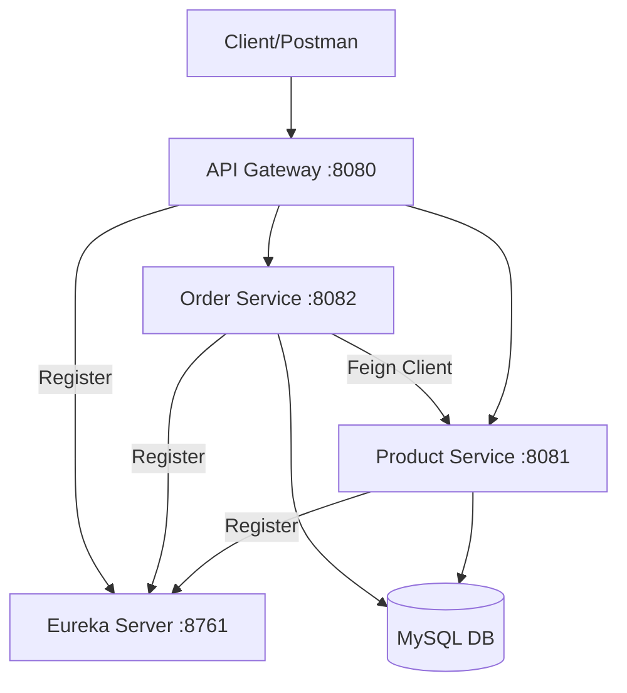
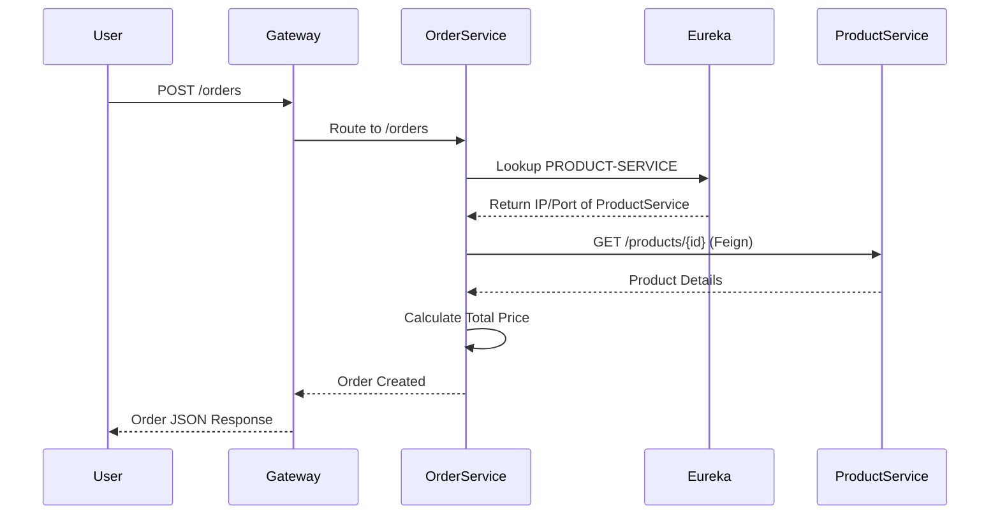

# Microservices Service Discovery System using Spring Boot & Eureka

This project demonstrates a complete microservices architecture featuring service registration and discovery using Netflix Eureka.

## Architecture Overview

The system consists of the following components:

1.  **Eureka Server**: Acts as the Service Registry (Port 8761).
2.  **Product Service**: Manages product CRUD operations (Port 8081).
3.  **Order Service**: Manages orders and communicates with Product Service via OpenFeign (Port 8082).
4.  **API Gateway**: Central entry point for all requests (Port 8080).
5.  **MySQL Database**: Persistent storage for all services.

### Architecture Diagram



### Service Communication Diagram



## Technology Stack

- **Spring Boot 3.2.5**
- **Spring Cloud 2023.0.1**
- **Netflix Eureka** (Discovery)
- **OpenFeign** (Inter-service Communication)
- **Spring Cloud Gateway** (Routing)
- **Spring Data JPA** (ORM)
- **MySQL** (Database)
- **Docker & Docker Compose** (Containerization)

## How to Run

### Prerequisites
- Java 17 or higher
- Maven 3.8+
- Docker & Docker Compose (Optional, but recommended)

### Method 1: Using Docker Compose (Recommended)

1.  Build all projects:
    ```bash
    mvn clean package -DskipTests
    ```
2.  Run the infrastructure:
    ```bash
    docker-compose up --build
    ```

### Method 2: Running Locally

1.  **Start MySQL**: Ensure a MySQL instance is running on localhost:3306.
2.  **Start Eureka Server**: Run `EurekaServerApplication`.
3.  **Start Product Service**: Run `ProductServiceApplication`.
4.  **Start Order Service**: Run `OrderServiceApplication`.
5.  **Start API Gateway**: Run `ApiGatewayApplication`.

## API Endpoints

### Product Service
- `GET /products`: List all products
- `POST /products`: Create a product
- `GET /products/{id}`: Get product by ID

### Order Service
- `GET /orders`: List all orders
- `POST /orders`: Create an order (validates product via Product Service)

### API Gateway (Entry Point)
- `GET http://localhost:8080/products`
- `GET http://localhost:8080/orders`

## Implementation Details

- **Dynamic Discovery**: Services use `@EnableDiscoveryClient` and find each other via application names (e.g., `PRODUCT-SERVICE`).
- **Feign Client**: Used in `Order Service` to call `Product Service` abstractly.
- **Load Balancing**: Spring Cloud LoadBalancer is automatically integrated with Feign and Gateway.
- **Fault Tolerance**: The system handles service restarts as Eureka dynamically updates the registry.
